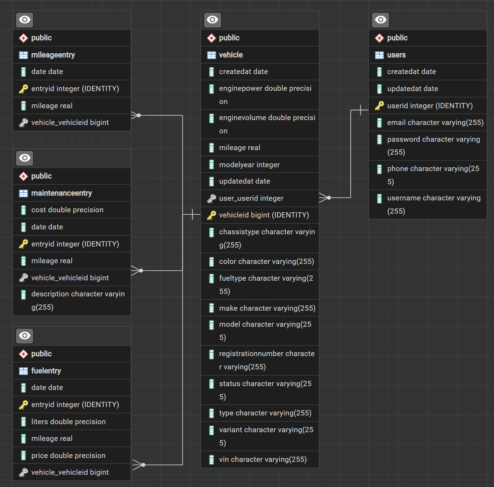

# VehicleTracker Backend API

### Vision: 
VehicleTracker is a REST API that allows users to register, manage, and keep track of their personal vehicles.  
Users can record fuel purchases, maintenance, and mileage readings, as well as retrieve statistics to analyse vehicle expenses, fuel consumption, and mileage over time.

### Links:
- **Base URL (local):** `http://localhost:7070/api/v1`
- **Deployed URL:** `http://alteredproject.vehicletracker.dk/api/v1`
- **Source code repository:** `https://github.com/AlteredProject/VehicleTracker`
- **Portfolio website:** `https://alteredproject.dk`

# Architecture
VehicleTracker is built with multiple backend layers:

### System Overview
VehicleTracker is built using a layered backend architecture. Each layer has a specific responsibility,  
helping separate HTTP handling, business logic, and database operations.

The application is structured into the following layers:

- **Controller layer:** Defines and registers REST API endpoints.
- **Handler layer:** Handles incoming HTTP requests, extracts request data, and returns HTTP responses.
- **Service layer:** Contains the application's business logic, including vehicle management, entry management, and statistics calculations.
- **DAO layer:** Handles database operations and communication with the database using JPA.
- **Entity layer:** Defines the application's database entities and their relationships.
- **DTO layer:** Defines the data structures used to receive requests and return responses without exposing database entities directly.
- **Security layer:** Handles JWT authentication and protects endpoints that require an authenticated user.

### Technologies
- **Java 25** – Main programming language.
- **Javalin** – Lightweight web framework used to build REST endpoints.
- **JPA / Hibernate** – ORM and persistence framework for database operations.
- **PostgreSQL** – Relational database.
- **Maven** – Dependency and project management.
- **JWT** – Token-based authentication and authorization.
- **Jackson** – JSON serialization and deserialization.
- **Lombok** – Reduces boilerplate code in entities and other Java classes.
- **JUnit 6** – Unit and integration testing.
- **REST Assured** – HTTP-based API testing.
- **MotorAPI** – External API used to retrieve vehicle information from registration numbers.

# Authentication
VehicleTracker uses JSON Web Tokens (JWT) for authentication.

Register an account using `POST /api/v1/users`, then log in using `POST /api/v1/auth/login` to receive an authentication token.

Include the token in the Authorization header when accessing protected endpoints:

```
Authorization: Bearer <token>
```
| Access        | Description                                                                         |
|---------------|-------------------------------------------------------------------------------------|
| PUBLIC        | No authentication required.                                                         |
| AUTHENTICATED | Requires a valid JWT. Users can only access their own vehicles and related entries. |

# API Endpoints
All endpoints use the following base URL:

```
http://localhost:7070/api/v1
```

### Authentication and Users
| Method | Endpoint    | Access | Description                           |
|--------|-------------|--------|---------------------------------------|
| POST   | /users      | PUBLIC | Register a new user                   |
| POST   | /auth/login | PUBLIC | Authenticate a user and receive a JWT |

### Vehicles
| Method | Endpoint              | Access        | Description                                               |
|--------|-----------------------|---------------|-----------------------------------------------------------|
| GET    | /vehicles             | AUTHENTICATED | Retrieve all vehicles belonging to the authenticated user |
| POST   | /vehicles             | AUTHENTICATED | Add a vehicle using its registration number               |
| GET    | /vehicles/{vehicleId} | AUTHENTICATED | Retrieve a specific vehicle                               |
| POST   | /vehicles/lookup      | AUTHENTICATED | Look up vehicle information using MotorAPI                |
| POST   | /vehicles/manual      | AUTHENTICATED | Manually add a vehicle                                    |
| PATCH  | /vehicles/{vehicleId} | AUTHENTICATED | Update vehicle information                                |

### Fuel Entries
| Method | Endpoint                                         | Acces         | Description                    |
|--------|--------------------------------------------------|---------------|--------------------------------|
| POST   | /vehicles/{vehicleId}/fuel-entries               | AUTHENTICATED | Add a fuel entry to a vehicle  |
| PATCH  | /vehicles/{vehicleId}/fuel-entries/{fuelEntryId} | AUTHENTICATED | Update a fuel entry            |

### Maintenance Entries
| Method | Endpoint                                                       | Acces         | Description                          |
|--------|----------------------------------------------------------------|---------------|--------------------------------------|
| POST   | /vehicles/{vehicleId}/maintenance-entries                      | AUTHENTICATED | Add a maintenance entry to a vehicle |
| PATCH  | /vehicles/{vehicleId}/maintenance-entries/{maintenanceEntryId} | AUTHENTICATED | Update a maintenance entry           |

### Mileage Entries
| Method | Endpoint                              | Acces         | Description                |
|--------|---------------------------------------|---------------|----------------------------|
| PATCH  | /vehicles/{vehicleId}/mileage-entries | AUTHENTICATED | Add a manual mileage entry |

### Statistics
| Method | Endpoint                         | Acces         | Description                       |
|--------|----------------------------------|---------------|-----------------------------------|
| GET    | /vehicles/{vehicleId}/statistics | AUTHENTICATED | Retrieve statistics for a vehicle |

**Statistics query parameters**  
The statistics endpoint accepts an optional period query parameter.

| Parameter | Type   | Values                 | Description                                     |
|-----------|--------|------------------------|-------------------------------------------------|
| period    | String | WEEK, MONTH, YEAR, ALL | Defines the time period used for the statistics |

**Example:**
```
GET /vehicles/1/statistics?period=YEAR
```

# Errors
Errors are returned as JSON responses with an appropriate HTTP status code.

| Status | Description                                                      |
|--------|------------------------------------------------------------------|
| 400    | Bad Request – Invalid input or missing required fields           |
| 401    | Unauthorized – Missing or invalid authentication token           |
| 404    | Not Found – Requested resource does not exist or is inaccessible |
| 409    | Conflict – Resource conflicts with existing data                 |
| 500    | Internal Server Error – Unexpected server-side error             |

**Example error response:**
```
{
  "error": "Description of the error"
}
```

# Data Model
